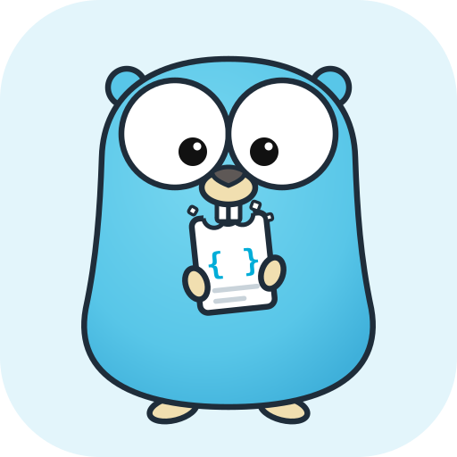

# om

[](https://github.com/holon-sh/om/actions/workflows/ci.yml)
[](https://go.dev/doc/install)
[](https://pkg.go.dev/github.com/holon-sh/om)
[](LICENSE)
[](https://discord.gg/jXExyBdy)



`om` turns an OpenAPI document into a standalone TypeScript [MCP server](https://modelcontextprotocol.io/docs/learn/server-concepts), with one tool per API operation.

## Install

```sh
go install github.com/holon-sh/om/cmd/om@latest
```

## Usage

```sh
om generate https://example.com/openapi.yaml my-api
cd my-api
npm ci
npm start
```

The server listens at `http://127.0.0.1:3000/mcp` and needs Node.js 22.18 or newer. `om generate` lists the environment variables that hold your API credentials and any operations it skipped.

The server has no authentication of its own. Put it behind one before exposing it beyond localhost.

## License

[MIT](LICENSE). The om gopher is based on the [Go gopher](https://go.dev/blog/gopher) by Renee French, licensed under [CC BY 4.0](https://creativecommons.org/licenses/by/4.0/).
